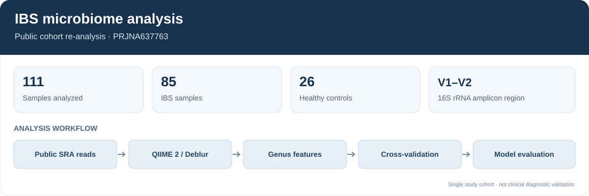
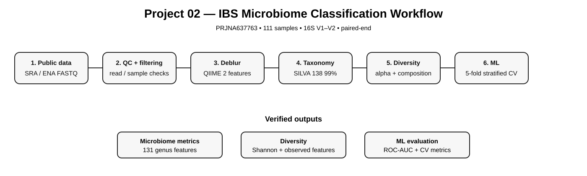

# IBS Microbiome Analysis and Machine Learning

This project re-analyses a public gut 16S rRNA dataset to examine microbial community patterns in IBS and healthy-control samples, then evaluates two genus-level classifiers using cross-validation.



## Dataset and scope

- **NCBI BioProject:** PRJNA637763
- **SRA study:** SRP266324
- **Cohort described in the source study:** 85 IBS samples and 26 healthy controls
- **Amplicon region:** V1–V2
- **Platform:** Illumina MiSeq, paired-end
- **Feature workflow:** QIIME 2, Deblur, SILVA 138 99% classifier
- **Model evaluation:** L1-regularized logistic regression and random forest with five-fold stratified cross-validation

This is an independent re-analysis of public data, not a reproduction of the original paper's exact preprocessing or model. It is not clinical diagnostic validation.

## Analysis workflow



1. Retrieve public sample/run metadata and identify the IBS and healthy-control groups.
2. Resolve SRA runs to ENA FASTQ files.
3. Import forward reads into QIIME 2, trim the target primer, and denoise with Deblur.
4. Assign taxonomy with the SILVA 138 99% classifier.
5. Calculate alpha diversity and genus-level relative abundance.
6. Evaluate classification using five-fold stratified cross-validation.
7. Save metrics, feature rankings, plots, and a report.

The classifier's prevalence filter, centered-log-ratio transformation, and standardization are fitted within each training fold to reduce information leakage. The separate L1 genus ranking is fitted on the full cohort and is exploratory; it is not used to estimate cross-validation performance.

## Results and interpretation

The committed `results/` directory contains a historical snapshot. Its model metrics are **not** treated as the verified output of the corrected pipeline. Use the `results_actual/` artifact from the latest successful GitHub Actions run for current metrics.


Compact quality-control, taxonomy, diversity, and model-summary files are included where practical. Large intermediate feature tables, representative sequences, raw FASTQ files, and QIIME 2 artifacts are not committed. The workflow creates fresh analysis outputs and uploads them as the `project02-ibs-results` artifact for 90 days.

## Run the analysis

Requirements: Docker, Bash, curl, Python 3, and Git.

From the repository root:

```bash
bash scripts/02_run_ibs_analysis.sh
```

The workflow downloads public sequencing reads and runs QIIME 2 in Docker. It can take substantial time and bandwidth because the study includes 111 public SRA experiments.

## Repository layout

```text
.
├── .github/workflows/ibs-microbiome.yml
├── docs/
├── figures/
├── metadata/
├── results/
├── scripts/
└── LICENSE
```

## Limitations

- The analysis covers one public cohort and depends on the sample labels available in its public metadata.
- The workflow uses forward reads for denoising; it does not merge paired reads.
- The model evaluation is internal cross-validation, not external validation on an independent cohort.
- Genus-level feature ranking is exploratory and should not be interpreted as a causal or diagnostic result.
- Results depend on the selected preprocessing, taxonomy database, and statistical choices.

No private company data or synthetic biological measurements are used. Third-party datasets, software, and reference databases remain subject to their own terms.

